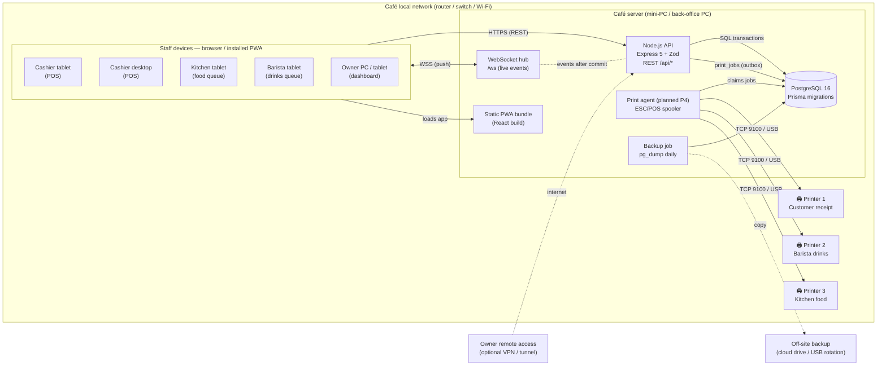

# Bite & Brew — System Architecture

> Status: Phase 1 implemented. Diagrams describe the full target system; components
> marked *(planned)* are designed but not yet built.

## 1. Goals that drive the design

| Requirement | Architectural answer |
|---|---|
| Several tills, kitchen, barista and owner screens at once | One central PostgreSQL database; every device is a thin client of one API server |
| Kitchen/barista/owner see new orders instantly | WebSocket push from the server after each committed transaction |
| Never sell the last portion twice | Stock changes inside one database transaction with conditional updates (`… WHERE qty >= n`) |
| No duplicate orders / payments | Client-generated idempotency keys stored with a UNIQUE constraint *(Phase 3)* |
| Staff must not silently overwrite each other | `version` column + optimistic concurrency → HTTP 409 on stale saves (implemented) |
| Internet in Dhaka can drop | **Server runs on the café LAN**; losing the internet does not stop the café (see OFFLINE.md) |
| Thermal printers on Ethernet / Wi-Fi / USB | Local **print agent** next to the printers, fed by a durable print-job queue *(Phase 4)* |
| Desktop + touchscreen tablets | Responsive React PWA; 48 px touch targets; no native app to install |
| Accounting correctness | Integer money (paisa), stock ledger, COGS from consumption — never from purchases |

## 2. System architecture diagram



### Request flow (example: a cashier saves a change)

1. Browser sends `PATCH /api/categories/:id` with the session cookie, the
   `x-bitebrew-client` CSRF header and the record's `version`.
2. Middleware: security headers → JSON parse (100 kB limit) → CSRF header check →
   session lookup (SHA-256 of cookie token) → permission check.
3. Handler validates input with the shared Zod schema, then opens a DB transaction:
   conditional update `WHERE id = ? AND version = ?` → audit row → commit.
4. After commit, the WebSocket hub broadcasts `categories.changed`; every connected
   device refetches only that data.

## 3. Technology choices and trade-offs

| Layer | Choice | Why | Alternatives considered |
|---|---|---|---|
| UI | React 19 + TypeScript + Vite 7 | Requested; large ecosystem; fast builds | — |
| Data fetching | TanStack Query | Caching, refetch-on-event, no global store needed | Redux (more boilerplate) |
| App shell | PWA (vite-plugin-pwa, Workbox) | Installs on Windows & Android tablets, opens without network | Electron (heavier; only needed if USB printing must run on each till) |
| API | Node 22 + Express 5 | Requested Node; Express 5 handles async errors natively; minimal | Fastify (faster, but speed is irrelevant at café scale), NestJS (heavier structure than needed) |
| Validation | Zod 4, **shared** between client & server | One definition of every rule | — |
| DB | PostgreSQL 16 | Real transactions, row locks, CHECK constraints, triggers | SQLite (no multi-writer concurrency) |
| ORM | Prisma 7 (driver adapter `@prisma/adapter-pg`) | Type-safe queries, versioned SQL migrations | Drizzle/Kysely (fine too; Prisma requested) |
| Realtime | `ws` (plain WebSocket) | Tiny, standard, authenticated by the same cookie | Socket.IO (adds its own protocol; unnecessary on a LAN) |
| Passwords | Argon2id (19 MiB, t=2) | OWASP current recommendation | bcrypt |
| Sessions | Opaque random token in httpOnly SameSite=Strict cookie; only SHA-256 stored | Revocable instantly (logout, role change, password reset) | JWT (cannot be revoked without a denylist) |
| Logs | pino (JSON) | Structured error logging, redacts cookies/passwords | — |
| Printing | Local print agent + ESC/POS over TCP 9100 *(P4)* | Browsers cannot open raw sockets; agent works for all devices | WebUSB / per-device drivers (fragile on tablets) |

**One deliberate deviation from "cloud by default":** the recommended production
server lives *inside the café* (see DEPLOYMENT.md). Internet outages then only
affect remote owner access and off-site backups — tills, kitchen and barista keep
working over the LAN. A cloud-hosted server is supported but makes every internet
outage a full outage.

## 4. Code layout

```
packages/shared/      Roles & permission matrix, Zod schemas, money (paisa) and
                      Asia/Dhaka time helpers, DTO types — used by server AND web
apps/server/
  prisma/             schema.prisma + versioned SQL migrations
  src/config          environment validation (fails fast on bad config)
  src/lib             prisma client, logger, errors, audit, password hashing
  src/middleware      session loading, RBAC, CSRF, error handler
  src/modules/<area>  routes (+ service) per business area
  src/realtime        WebSocket hub
  src/scripts         seed (base), seed-demo (guarded), create-owner
  tests/              API tests (vitest + supertest) on a throwaway database
apps/web/
  src/api             fetch wrapper (CSRF header, typed errors)
  src/auth            session context
  src/realtime        connectivity + live-update context
  src/layout          app shell, navigation config
  src/pages           one file per screen
e2e/                  browser acceptance tests (Playwright)
docs/                 this documentation + ADRs + progress log
scripts/              dev launcher, backup/restore
```

## 5. Cross-cutting rules (enforced in code)

- **Money**: integer minor units (`…Minor` columns, paisa). Formatting via `formatMoney`
  with the owner's symbol/decimals/grouping. Never floats.
- **Time**: stored UTC (`timestamptz`); displayed and grouped into business days in
  `BusinessSettings.timezone` (default `Asia/Dhaka`), never the device's zone.
- **Concurrency**: every editable row has `version`; writes are conditional.
- **Audit**: sensitive changes write an `audit_logs` row *in the same transaction*.
  The table is append-only (database trigger).
- **Authorisation**: enforced on the server for every route; the UI only hides controls.
- **Validation**: Zod on the server for every body/query; DB CHECK constraints as a backstop.
- **No sample data in production**: demo accounts can only be created when `APP_ENV≠production`;
  non-production builds show a striped "demo data only" banner on every screen.
