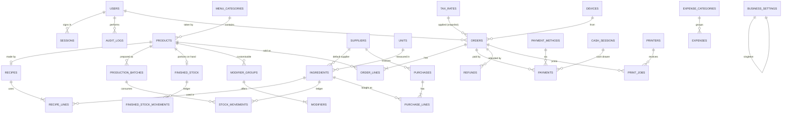

# Bite & Brew — Database Design

PostgreSQL 16, managed through Prisma migrations (`apps/server/prisma`).

**Conventions**
- Primary keys: UUID (safe to generate on offline devices); `audit_logs` uses BIGSERIAL.
- Money: `BIGINT`/`INT` minor units (paisa) in columns ending `_minor`. Never floating point.
- Quantities: `NUMERIC(14,3)` in the ingredient's **base unit** (g, mL or pcs).
- Timestamps: `timestamptz` (UTC). `business_date` columns are `DATE` in café time.
- Editable rows have `version INT` for optimistic concurrency.
- Ledgers (stock movements, payments, audit) are **append-only**: corrections are new rows.

## 1. Entity relationship diagram (target model)

Built: **Phase 1** `users`, `sessions`, `business_settings`, `menu_categories`, `audit_logs`; **Phase 2** `suppliers`, `ingredients`, `stock_movements`, `products`, `product_images`, `recipe_lines`, `modifier_groups`, `modifiers`, `finished_movements`, `production_batches`.
POS/printing/finance (migration `…_pos_printing_finance`): `tax_rates`, `payment_methods`, `cash_sessions`, `orders`, `order_lines`, `payments`, `refunds`, `printers`, `print_jobs`, `expense_categories`, `expenses` — with CHECK constraints (paid ≤ total, refunded ≤ paid, positive amounts, 58/80 mm paper), append-only triggers on `payments` and `refunds`, and a unique index allowing only one open cash drawer.

## 2. Phase 1 schema (implemented)

See `apps/server/prisma/schema.prisma` and the two migrations:

| Migration | Contents |
|---|---|
| `…_phase1_foundation` | enums `Role`, `MenuGroup`, `PrepStation`, `NumberGrouping`; tables `users`, `sessions`, `business_settings`, `menu_categories`, `audit_logs` with indexes |
| `…_db_integrity_guards` | CHECK constraints (settings singleton `id = 1`, currency code `^[A-Z]{3}$`, 0–3 decimals, day-start hour 0–23, at least one service type, username format, non-blank category names); **append-only trigger** on `audit_logs` (blocks UPDATE/DELETE, allowing only the FK's `ON DELETE SET NULL`) |

| Table | Key columns | Notes |
|---|---|---|
| `users` | `username` UNIQUE, `password_hash` (argon2id), `role`, `is_active`, `failed_login_count`, `locked_until`, `version` | Lockout after 5 failures for 15 min |
| `sessions` | `token_hash` UNIQUE (SHA-256), `expires_at`, `revoked_at`, `ip_address`, `user_agent` | Raw token exists only in the httpOnly cookie |
| `business_settings` | singleton; name, tagline, established year, contact, `currency_code` BDT, `currency_symbol` ৳, `currency_decimals` 2, `number_grouping` LAKH, `timezone` Asia/Dhaka, `business_day_start_hour`, dine-in/takeaway flags, receipt footer, `version` | Defaults reflect the agreed business configuration |
| `menu_categories` | `name`, `normalized_name` UNIQUE (case-insensitive uniqueness), `group` FOOD/DRINKS/DESSERTS, `station` KITCHEN/BARISTA, `sort_order`, `is_active`, `version` | `station` routes tickets to printer 2 or 3 |
| `audit_logs` | `occurred_at`, `actor_id`, `action`, `entity_type`, `entity_id`, `before` JSONB, `after` JSONB, `ip_address`, `user_agent` | Secrets are scrubbed before writing |

## 3. Phase 2 schema (implemented)

Migration `…_phase2_products_inventory` (+ hand-written guards in the same file):
CHECK constraints (stock ≥ 0, prices ≥ 0, recipe quantity > 0, wastage 0–99.99 %, unit must
match dimension, modifier min ≤ max) and **append-only triggers** on `stock_movements`,
`finished_movements` and `production_batches`.

Differences from the original plan, decided while building:
- **Units** are a fixed list in code (g, kg, mL, L, pcs, dozen) instead of a `units` table —
  conversions stay exact and cannot be mis-edited. Ingredients store a `dimension` and a
  `display_unit`; quantities are kept in the base unit.
- **Finished stock** lives on `products` (`portions_on_hand`, `portion_cost_minor`) instead of
  a separate `finished_stock` table; it changes only through `finished_movements`, under a row lock.
- **Product photos** are stored in the database (`product_images`, resized to ≤ 640 px in the
  browser) so the daily backup contains them — no separate file storage to back up.
- **Idempotency**: `request_id` UNIQUE on both ledgers and on `production_batches`; a
  double-tapped "Record" or "Receive" returns the first result.
- Stock is changed only by `apps/server/src/modules/inventory/stock.ts`, which locks rows
  (`SELECT … FOR UPDATE`, products then ingredients, ordered by id — deadlock-free).

### Inventory (as designed — see notes above for what changed)

| Table | Columns (abridged) | Rules |
|---|---|---|
| units *(implemented in code)* | g, kg, mL, L, pcs, dozen; `dimension` MASS/VOLUME/COUNT | kg→g = 1000, L→mL = 1000, dozen→pcs = 12. Conversions only within one dimension |
| `suppliers` | name, phone, address, notes, `is_active` | |
| `ingredients` | name, `dimension`, `base_unit`, `display_unit`, `on_hand_base` NUMERIC(14,3) (cached), `avg_cost_minor_per_base` NUMERIC(14,4), `min_level_base`, `default_supplier_id`, `is_packaging`, `version` | `on_hand_base` is only changed in the same transaction that inserts a `stock_movements` row; CHECK `on_hand_base >= 0` unless an override movement is recorded |
| `stock_movements` | `ingredient_id`, `type` (PURCHASE, PRODUCTION_CONSUME, SALE_CONSUME, WASTE, SPOILAGE, ADJUSTMENT, COUNT_CORRECTION, RETURN_TO_SUPPLIER, SYNC_CONFLICT), `qty_delta_base`, `unit_cost_minor`, `value_minor`, `balance_after_base`, `ref_type`/`ref_id`, `reason`, `actor_id`, `device_id`, `occurred_at` | Append-only ledger. PRODUCTION_CONSUME converts raw stock into finished-goods stock (still an asset); SALE_CONSUME is COGS |
| `products` | `category_id`, name, `price_minor`, `station` (override of category), `stock_mode` (BATCH / MADE_TO_ORDER / RESALE / UNTRACKED), `image_path`, `is_available`, `sort_order`, `version` | |
| `recipes` / `recipe_lines` | `product_id`, `yield_portions`; lines: `ingredient_id`, `qty_base`, `wastage_pct` | Effective usage = qty × (1 + wastage) |
| `production_batches` | `product_id`, recipe snapshot JSONB, `planned_portions`, `actual_portions`, `total_cost_minor`, `unit_cost_minor`, `prepared_by`, `prepared_at`, `expires_at` | Consumes raw ingredients **once**, creates finished portions |
| `finished_stock` | `product_id` PK, `on_hand`, `reserved`, `version` | CHECK `on_hand >= 0`, `reserved >= 0` |
| `finished_stock_movements` | `product_id`, `type` (PRODUCED, SOLD, CANCEL_RESTORE, WASTE, SPOILAGE, ADJUSTMENT, RESALE_PURCHASE), `qty_delta`, `unit_cost_minor`, `ref_*`, `actor_id` | Selling BATCH items moves only this ledger — never raw stock again |

**Biriyani example**: prepare 20 → `production_batches` row + PRODUCTION_CONSUME rows for
rice/chicken/oil/spices (COGS value captured) + PRODUCED +20. Sell 3 → SOLD −3 → POS shows 17.
No raw ingredient movement at sale time.

**Made-to-order** (e.g. a latte): sale inserts SALE_CONSUME rows for milk, beans, cup.
Availability = min over recipe lines of ⌊on_hand ÷ effective qty⌋.

### Sales (Phase 3)

| Table | Columns (abridged) |
|---|---|
| `devices` | name, kind (TILL/KITCHEN/BARISTA/OWNER), `order_prefix`, `offline_orders_allowed`, `last_seen_at` |
| `tax_rates` | name, `rate_bp` (basis points, e.g. 750 = 7.5 %), `inclusive`, `is_active` — **no default rate; owner configures** |
| `payment_methods` | code (CASH, CARD, BKASH, NAGAD, …), label, `requires_reference`, `is_active`, sort |
| `orders` | `order_no` (per business day), `business_date`, `service_type` DINE_IN/TAKEAWAY, `table_no`, `status` (HELD, OPEN, IN_PREPARATION, READY, COMPLETED, CANCELLED), `payment_status` (UNPAID, PARTIALLY_PAID, PAID, PARTIALLY_REFUNDED, REFUNDED), `subtotal_minor`, `discount_minor`, `tax_minor`, `total_minor`, tax snapshot JSONB, `client_request_id` **UNIQUE** (idempotency), `device_id`, `created_by`, `version` |
| `order_lines` | `product_id`, name/price snapshot, `qty`, `modifiers` JSONB, `notes`, `station`, `prep_status`, `stock_state` (RESERVED, CONSUMED, RELEASED, WASTED), `cost_minor` |
| `payments` | `order_id`, `method_id`, `amount_minor`, `tendered_minor`, `change_minor`, `reference` (bKash/Nagad TrxID, card slip no. — **never card numbers**), `idempotency_key` UNIQUE, `cash_session_id`, `received_by` |
| `refunds` | `order_id`, `payment_id`, `amount_minor`, `reason`, `stock_action` (RESTORE / WASTE / NONE), `approved_by` |
| `cash_sessions` | `device_id`, `opened_by`, `opening_float_minor`, `closed_by`, `counted_minor`, `expected_minor`, `variance_minor`, denominations JSONB |

Order number uniqueness: `UNIQUE (business_date, order_no)`; offline orders use a device
prefix (e.g. `T2-014`) so numbers never collide.

### Printing (Phase 4)

| Table | Columns |
|---|---|
| `printers` | name, `role` (RECEIPT / BARISTA / KITCHEN), `connection` (NETWORK / USB / AGENT_LOCAL), host, port (9100), `paper_mm` 58/80, `chars_per_line` (32/42/48), `profile` (command set / code page), `cut`, `drawer_kick`, `is_active`, `status`, `last_seen_at`, `last_error` |
| `print_jobs` | `idempotency_key` UNIQUE (order + destination + kind + reprint number), `printer_id`, `kind` (RECEIPT / TICKET / TEST / REPORT), `payload` JSONB (structured, rendered by the agent), `status` (PENDING, CLAIMED, PRINTED, FAILED, CANCELLED), `attempts`, `claimed_at`, `printed_at`, `error`, `requested_by`, `reprint_of`, `reprint_reason` |

### Finance (Phase 5)

| Table | Columns |
|---|---|
| `purchases` / `purchase_lines` | supplier, invoice no, `purchased_at`, `total_minor`, paid status; lines: ingredient, qty + unit, `qty_base`, `unit_cost_minor` → PURCHASE stock movement and weighted-average cost update. **Purchases are inventory (an asset), not COGS.** |
| `expense_categories` | Rent, Electricity, Water, Internet, Salaries, Repairs, Transportation, Cleaning, Marketing, Other (editable) |
| `expenses` | category, `amount_minor`, `incurred_on` (business date), payment method, note, receipt file, `created_by` |

### Reporting identities

- **Revenue** = Σ order lines at selling price − discounts (excl. VAT if prices are tax-inclusive)
- **COGS** = Σ SOLD finished-stock movements × batch unit cost (batch items)
  + Σ SALE_CONSUME values (made-to-order items) + resale items at purchase cost.
  Batch preparation itself is **not** COGS: it moves value from raw stock into finished
  portions; that value becomes COGS only when portions are sold.
- **Inventory losses** = waste / spoilage / negative count corrections (raw or finished), reported separately
- **Gross profit** = Revenue − COGS
- **Net profit (estimate)** = Gross profit − operating expenses − inventory losses
- **Stock value** = Σ on_hand × average cost (raw) + Σ finished on_hand × batch unit cost
