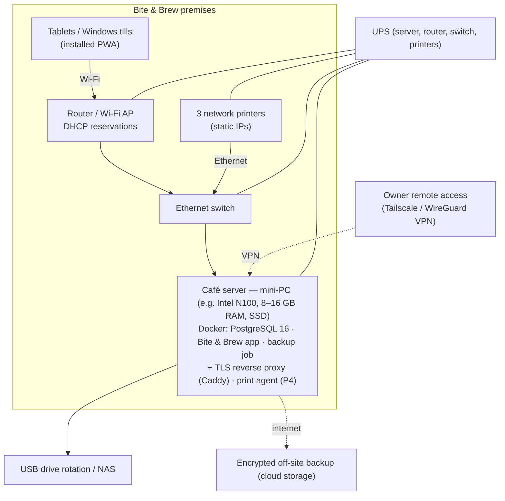

# Bite & Brew — Deployment

## 1. Recommended architecture (on-premises primary)



| Option | Pros | Cons | Verdict |
|---|---|---|---|
| **On-premises server** (recommended) | Works through internet outages; fastest; printers on same LAN | You own the hardware; needs UPS and off-site backups | ✅ Primary |
| Cloud server (VPS) | No local hardware; easy remote access | **Every internet outage stops the tills**; printers need a local agent anyway | Use only with a reliable dual-ISP setup |
| Hybrid (local primary + cloud replica) | Best resilience & remote reporting | More moving parts | Consider after go-live |

## 2. Server installation (Docker)

```bash
git clone <repo> bitebrew && cd bitebrew
cp .env.docker.example .env.docker      # set POSTGRES_PASSWORD (long, random) and WEB_ORIGIN
docker compose --env-file .env.docker up -d --build
# First owner account (prompts for username, name, password):
docker compose --env-file .env.docker exec app sh -c "cd apps/server && npx tsx src/scripts/create-owner.ts"
```

The `app` container applies pending migrations (`prisma migrate deploy`) and the base
seed (settings + the nine starting categories, idempotent) on every start, then serves
the API, WebSocket and PWA on port 4000. The `backup` container dumps the database daily.

**HTTPS is required in production** (`COOKIE_SECURE=true`; the server refuses to start in
production without it). Put Caddy in front, e.g. `Caddyfile`:

```
bitebrew.local {
  tls internal            # local CA; install its root certificate on each tablet once
  reverse_proxy localhost:4000
}
```

Alternatively use a real domain with Let's Encrypt via DNS challenge, or Tailscale HTTPS.

## 3. Without Docker (Windows PC)

1. Install Node.js 22 LTS and PostgreSQL 16 (Windows installer).
2. Create a database and user; copy `apps/server/.env.example` → `apps/server/.env`, set
   `APP_ENV=production`, `DATABASE_URL`, `WEB_ORIGIN`, `COOKIE_SECURE=true`.
3. `npm ci && npm run build && npm run db:deploy && npm run db:seed && npm run create-owner`
4. Run `npm start` as a Windows service (e.g. NSSM) behind Caddy for HTTPS.
5. Schedule `scripts/backup.ps1` daily with Task Scheduler.

## 4. Tablets and tills

- Open `https://bitebrew.local` (or the server's address) in Chrome/Edge → **Install app**.
- Reserve each device's IP in the router; name devices (Phase 3 device registration).
- Set tablets to never sleep while charging on the counter; enable kiosk/screen pinning.

## 5. Backups and recovery

| Item | Implementation |
|---|---|
| Daily automated backup | `backup` container / `scripts/backup.sh` / `scripts/backup.ps1` → compressed `pg_dump` custom format, verified readable, SHA-256 checksum, 30-day retention |
| Off-site copy | Copy the backup folder to cloud storage (encrypted) or rotate USB drives weekly |
| Restore | `scripts/restore.sh` into a **new empty database**, verify counts, then repoint `DATABASE_URL` |
| Restore drill | Do a test restore monthly. Verified in Phase 1 (see TEST_RESULTS.md) |
| Point-in-time recovery | Optional later: enable WAL archiving for minute-level recovery |

**Recovery procedure (server failure)**
1. Install the app on replacement hardware (section 2).
2. Restore the latest backup into the new database (`scripts/restore.sh`).
3. Start the app — migrations bring the schema up to date.
4. Sign in as owner, check the audit log and the last orders; reprint anything needed.

## 6. Operations checklist

- Logs: `docker compose logs app` (structured JSON, passwords/cookies redacted).
- Health: `GET /api/health` (503 when the database is down) — use for uptime monitoring.
- Updates: `git pull && docker compose up -d --build` (take a backup first; migrations are forward-only).
- Never run `npm run db:seed:demo` in production — it refuses when `APP_ENV=production`.
