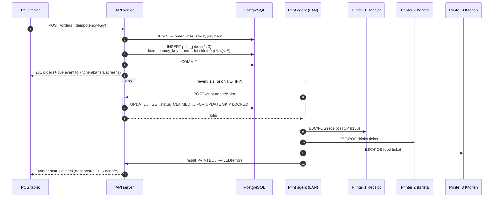
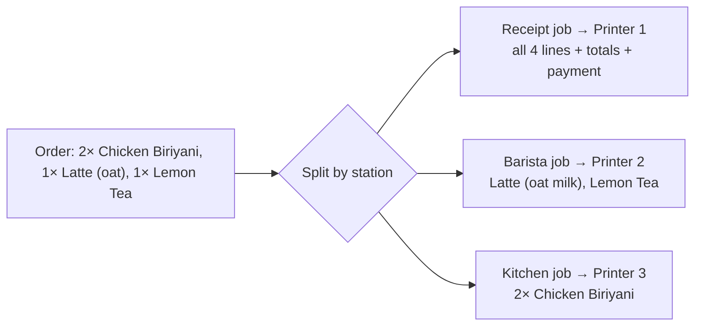

# Bite & Brew — Three-Printer Architecture

> **Status: built and tested against a simulated network printer. Not yet tested on real
> printers** (none purchased). Physical printing is not claimed to work until verified with
> the café's printers using the test procedure below.
>
> Implementation: `apps/server/src/modules/printing/` (queue, ESC/POS, print service) and
> `packages/shared/src/printing.ts` (receipt/ticket layout). The print service runs inside the
> café server (env `PRINT_SERVICE=on`, default) and talks raw TCP to each printer's IP.

## 1. Destinations

| # | Role | Receives | Typical placement |
|---|---|---|---|
| 1 | `RECEIPT` | Complete customer receipt (all items, discounts, VAT, payments, change) | Cashier counter (often with cash-drawer kick) |
| 2 | `BARISTA` | Drinks-only ticket (Coffee, Tea, Beverages — any item whose station is BARISTA) | Coffee bar |
| 3 | `KITCHEN` | Food-only ticket (Tehari, Biriyani, Khichuri, Burgers, Wraps, Desserts — station KITCHEN) | Kitchen pass |

Routing uses each item's **preparation station**: product override, else its category's
`station` (already stored on menu categories in Phase 1).

## 2. Architecture diagram

An order with no drinks produces no barista job (and vice versa).

## 3. Why a print service on the café server

Browsers on tablets cannot open raw TCP sockets or USB devices. A small Node service
(the **print agent**) runs on the café server PC (or any always-on PC on the LAN):

- Talks **ESC/POS over TCP port 9100** to Ethernet/Wi-Fi printers — works from any device.
- Supports **USB printers** attached to the PC running the agent (via the OS printer
  queue in raw mode, or direct USB). USB printers attached to a tablet are not supported.
- Renders structured job payloads into ESC/POS for each printer's **profile**:
  paper width (58 mm ≈ 32 chars, 80 mm ≈ 42/48 chars), code page, cut command,
  cash-drawer pulse, logo/bitmap support.
- Taka sign (৳) and Bangla text are usually **not** in printer code pages; the agent will
  print `Tk` or render the line as a bitmap — chosen per printer profile after testing.

## 4. Reliability rules

| Risk | Control |
|---|---|
| Duplicate tickets | `print_jobs.idempotency_key` UNIQUE; job created inside the order transaction (outbox pattern); agent marks result once; retries reuse the same job |
| Order saved but ticket lost | Jobs are durable rows; agent re-claims CLAIMED jobs older than N seconds; failures stay visible until resolved |
| Printer offline / out of paper | Agent probes status (DLE EOT where supported); POS + dashboard show red printer status; kitchen/barista screens still show the order |
| Wrong reprint use | Reprint requires `orders.reprint`, a reason, prints "REPRINT #n" header, audited |
| Two agents running | `FOR UPDATE SKIP LOCKED` claiming; agent identity recorded on each job |
| Failures | Every failure stored on the job (`error`, `attempts`) and in the error log |

## 5. Printer compatibility checklist (before buying)

Ask the supplier / test in-store with a laptop before purchase:

- [ ] **ESC/POS command set** compatible (Epson TM-series compatible is safest).
- [ ] **Ethernet (RJ45) or Wi-Fi** with **raw TCP 9100** printing ("RAW"/"JetDirect"). Ethernet strongly preferred for the kitchen (Wi-Fi + heat/steam is unreliable).
- [ ] Supports a **static IP** or DHCP reservation (configure in your router).
- [ ] **80 mm** paper recommended for kitchen and barista (larger text); 58 mm acceptable for receipts.
- [ ] **Auto-cutter** included.
- [ ] Prints a **status/self-test page** showing IP address.
- [ ] Real-time **status reporting** (paper-out, cover-open) via DLE EOT / ASB — nice to have.
- [ ] **Cash drawer port** (RJ11/RJ12 "DK" port) on the receipt printer if a drawer will be used.
- [ ] Kitchen printer: consider **impact printer or heat-resistant thermal paper** near hot equipment.
- [ ] Code page / character support: check whether `৳` and Bangla can print natively; otherwise bitmap.
- [ ] Local warranty and paper-roll availability in Dhaka.
- [ ] Power: use a UPS for the router, server PC and printers.

**Test procedure once printers arrive** (to be done in Phase 4, with results recorded in
`docs/TEST_RESULTS.md`): self-test page → ping IP → raw TCP test from the agent → test print
from the Printers screen on every paper width → full order split → pull Ethernet cable
mid-job (job must be retried, never duplicated) → paper-out → reprint flow.
